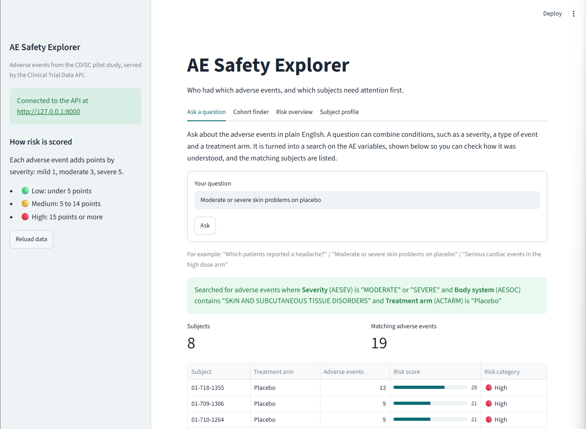
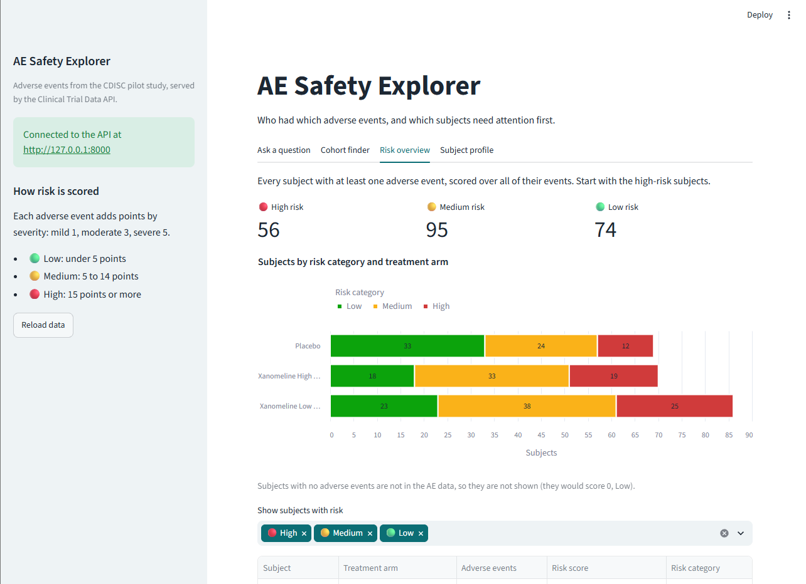

# AE Safety Explorer

[](https://github.com/Eniola-Ajayi/ae-safety-explorer/actions/workflows/tests.yml)

A Python API and web app for exploring clinical trial **adverse event (AE)
data**, including **plain-English questions answered by a language model**,
built on the CDISC ADaM ADAE dataset from the
[pharmaverse](https://pharmaverse.org/) (synthetic data, no real patients).

* **FastAPI** service: cohort queries, subject risk scores, and a `/ask`
  endpoint that turns a question such as *"moderate or severe skin problems on
  placebo"* into validated filters on the data.
* **Streamlit** app for investigators and medical monitors, so they get
  answers without writing code or calling an API.
* **53 pytest tests**, run by GitHub Actions on every push.



## What the app does

| Tab | Question it answers | API calls |
|---|---|---|
| **Ask a question** | Anything in plain English, including combined conditions, e.g. "Moderate or severe skin problems on placebo" | `POST /ask` |
| **Cohort finder** | Which subjects had AEs of this severity, in this arm? | `POST /ae-query` |
| **Risk overview** | Which subjects need attention first, and how does each arm compare? | `GET /risk-summary` |
| **Subject profile** | What is this subject's score, and what AEs make it up? | `GET /subject-risk/{id}`, `GET /subjects/{id}/events` |

The "Ask a question" tab always shows how the question was understood, for example

> Searched for adverse events where **Severity** (AESEV) is "MODERATE" or
> "SEVERE" and **Body system** (AESOC) contains "SKIN AND SUBCUTANEOUS TISSUE
> DISORDERS" and **Treatment arm** (ACTARM) is "Placebo"

so the answer can be checked rather than taken on trust. Results can be
downloaded as CSV.



## How plain-English questions work

The language model never touches the data. It only translates the question
into a structured plan, which is checked before plain pandas code applies it:

```
question ──(1) Prompt──> LLM ──(2) Parse + validate──> filters ──(3) Execute (pandas)──> subjects
```

1. **Prompt.** The model sees a description of each AE column plus real
   example values from the data (so it writes "MODERATE", not "Moderate"),
   never subject IDs or individual records.
2. **Parse.** The reply must be JSON, for example

   ```json
   {"filters": [{"column": "AESEV",  "values": ["SEVERE"]},
                {"column": "AETERM", "values": ["HEADACHE"]},
                {"column": "ACTARM", "values": ["Placebo"]}]}
   ```

   and is validated with pydantic. A column that isn't in the data, a value
   that doesn't exist (such as ACTARM "High Dose"), or the same column used
   twice is rejected with a clear message, instead of quietly returning a
   wrong answer.
3. **Execute.** Filters combine with **AND** (all must hold for the same AE
   record); values within one filter combine with **OR** ("mild or moderate").
   Coded columns are matched exactly, text columns by "contains".

**Model choice.** If `OPENAI_API_KEY` is set, it uses OpenAI through LangChain
(`temperature = 0`, so the same question gives the same answer). Without a
key, an offline stand-in follows exactly the same prompt, parse and execute
steps by matching the question against values in the data, so everything runs
and is tested without a key.

## How it fits together

```
Browser ──> app.py (Streamlit) ──HTTP──> api.py ──> main.py                core endpoints
                                            └─────> extended_service.py ──┬──> ae_service.py      scoring rules
                                                    (app endpoints)       └──> multi_agent.py ──> clinical_agent.py
```

| File | Purpose |
|---|---|
| `main.py` | Core API: `GET /`, `POST /ae-query`, `GET /subject-risk/{id}` |
| `ae_service.py` | Filtering and risk-score rules, as plain pandas functions |
| `api.py` | The full API: the core endpoints plus `/options`, `/risk-summary`, `/subjects/{id}/events` and `/ask` |
| `extended_service.py` | Logic for those extra endpoints (reuses `ae_service`) |
| `clinical_agent.py` | One question → one filter: schema, prompt, parsing, model choice |
| `multi_agent.py` | One question → several filters, built on `clinical_agent.py` |
| `app.py` | The Streamlit app |
| `ask.py` | Try the one-filter assistant from the command line |
| `tests/` | pytest tests |
| `data/` | `adae.csv` and the R script that exports it |

Design choices:

* **Business logic is separate from the web layer.** The rules live in plain
  functions, so they can be tested without a web server, and are defined once:
  a test checks that `/risk-summary` gives the same score as `/subject-risk`
  for every subject.
* **The app never touches the data.** Every number comes from the API, so any
  other front end (Shiny, Power BI, a scheduled report) would show the same
  results.
* **The data is loaded once,** when the API starts, not on every request.
* **Colours carry meaning.** Red, amber and green are used only for risk
  categories, always with an icon and a text label. Controls use a neutral
  teal.

### Risk score

Each AE scores **MILD = 1, MODERATE = 3, SEVERE = 5** points (missing = 0),
summed per subject: **Low** below 5, **Medium** 5 to under 15, **High** 15 or
more. An unknown subject returns 404.

## Run it

```bash
pip install -r requirements.txt
```

Then, from this folder, in two terminals:

```bash
uvicorn api:app --reload      # terminal 1: the API on http://127.0.0.1:8000
streamlit run app.py          # terminal 2: the app, opens in your browser
```

* All endpoints are documented at <http://127.0.0.1:8000/docs>.
* To use a real LLM, set `OPENAI_API_KEY` in terminal 1 **before** starting
  the API (the API, not the app, calls the model). Never commit keys: `.env`
  is git-ignored.
* Command-line demo: `python ask.py`, or `python ask.py --chat` to ask your
  own questions.

## Tests

```bash
python -m pytest -v
```

53 tests, on small hand-made datasets with known answers. They never call
OpenAI, even if a key is set. They check the endpoints, the risk scoring, that
`/ask` agrees with `/ae-query` and with the one-filter agent, and that bad
replies from a language model (no JSON, unknown column, made-up value, same
column twice, too many filters) are stopped with a clear message.

## Limitations and next steps

* **Population.** Only subjects with at least one AE are in ADAE. A production
  version would join to ADSL for the full safety population.
* **Prototype, not production.** No login or audit trail. A GxP deployment
  would add authentication, role-based access (for example to protect
  blinding), HTTPS, logging of who viewed what, and a validated data source
  with a data cut-off.
* **Conditions apply to one AE record at a time.** "Headache and nausea" is
  answered as "headache or nausea" (and the app says so); finding subjects
  with both would need a subject-level step.
* **Questions only filter the AE variables shown to the model**: no counts by
  group, dates or lab values.

## Data

`data/adae.csv` comes from the
[`pharmaverseadam`](https://pharmaverse.github.io/pharmaverseadam/) R package
(Apache 2.0): synthetic data based on the CDISC pilot study. See
[`data/README.md`](data/README.md).
